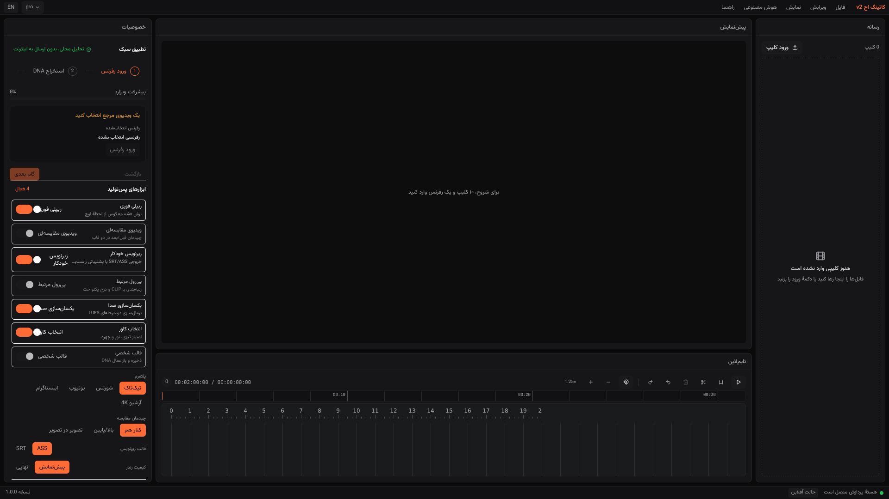
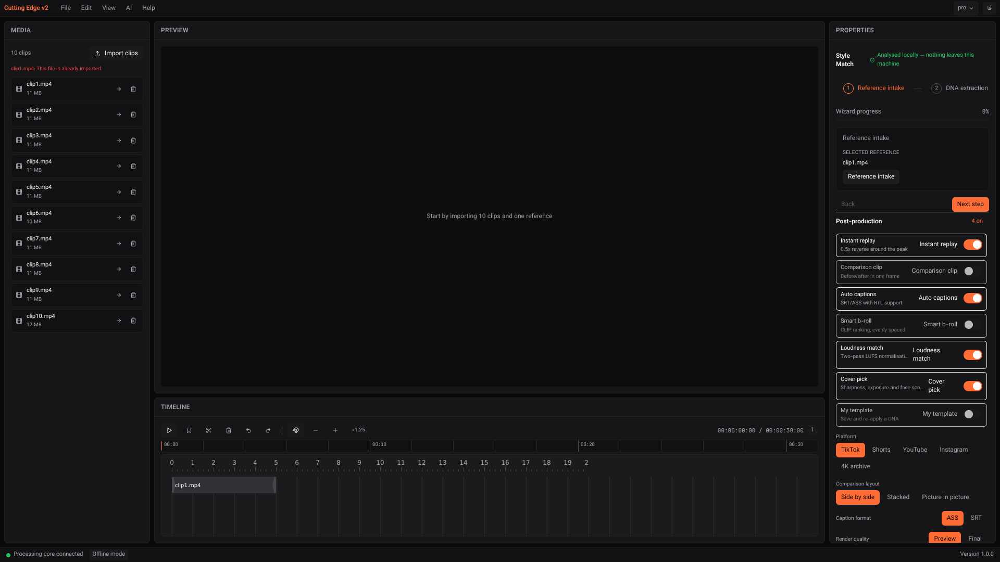

# Local test evidence — Cutting Edge Studio v1.0.0

Date: **2026-11-04** · Branch: `arena/dbb53bc2-cutting-edge-studio` · PR: **#1**

> **Subsequent recovery:** [RECOVERY-ROADMAP.md](RECOVERY-ROADMAP.md) and
> [RECOVERY-R1-REPORT.md](RECOVERY-R1-REPORT.md) record the next iteration. Real browser import
> and source playback now work locally; analysis/export remain blocked. The observations below
> are the historical baseline, not a claim that the repaired import is still metadata-only.

## نتیجهٔ اجرایی / Verdict

**آمادهٔ انتشار نیست — RELEASE BLOCKED.** تست‌های واحد و کنترل‌های ظاهری سبز هستند، اما مسیر واقعی «ورود فایل → تحلیل → پیش‌نمایش → خروجی» از رابط کاربری هنوز به backend متصل نیست. نصب‌کنندهٔ ویندوز و خروجی H.264 با انکودر مجاز در این محیط تأیید نشده‌اند. عدد تاریخی **260/260 (100%)** شمارش مراحل پیاده‌سازی قبلی است، نه درصد پذیرش محصول.

The audit used the requested **[morluto/rea](https://github.com/morluto/rea)**, npm package **`rea-agents@6.7.0`**, not a similarly named fork. REA was installed as an **external development tool**, not bundled into the app. No agent setup/configuration was overwritten. Only this project's own build and local browser page were inspected.

## 1. Environment and scope

- Debian 12 / Linux x86_64; Python 3.11.2; Node 22.22.3.
- Backend restarted from current source, bound to loopback `127.0.0.1:8756`.
- `CUTTING_EDGE_HOME=/tmp/ce-home`; `CUTTING_EDGE_DATA_DIR=/home/user/.local/share/CuttingEdgeV2`.
- Vite serves on `0.0.0.0:1420`; browser API requests use relative `/api` URLs through its proxy.
- Playwright **1.64.1**, headless Chromium **153.0.8010.0** from `@sparticuz/chromium@153.0.0` (npm). The standard Playwright CDN download was blocked. Its bundled NSS libraries were extracted into an external tool directory; no app dependency was changed for this workaround.
- No inference model weights installed; no usable NVENC GPU; temporary FFmpeg lacks `libopenh264`.
- Local media: ten portrait H.264/AAC clips and one 20-second reference. Media, SQLite databases, browser binaries, model files and rendered videos are **not committed**.

This is a component/API/browser audit, **not** successful full Windows desktop acceptance. Unit tests use fixtures; Style Match analysis contains both FFmpeg measurements and supplied synthetic annotations.

## 2. Results

| Check | Observed result | What it proves / does not prove |
|---|---|---|
| Backend pytest | **124 passed**, **94.01%** coverage, gate 80% | Unit/API regression coverage; not real model inference |
| Backend ruff | Check and formatting clean | Current backend source, including packaging regression tests |
| Frontend ESLint | Passed, max warnings 0 | Source lint |
| Frontend Vitest | **108 passed**, 15 files | Component/store tests; React `act(...)` warnings remain in test output |
| Frontend production build | Passed, TypeScript + Vite | Browser bundle builds; not a Windows installer |
| Live post-production requests | **12/12 passed** | Replay/comparison plans, ASS RTL, loudness plan/invalid input, embedding ranking, template save/read/apply, EDL validation, proxy completion |
| Browser interaction checks | **12/12 passed**, no `pageerror` events | RTL/LTR, themes, import metadata, duplicate feedback, visible timeline clip, wizard state, post controls, command palette |
| Route inventory smoke sweep | 31 entries: **18 requests**, **13 skipped** | Nine 200s and nine expected 404s for literal placeholder IDs; zero observed 5xx. This is **not 31 successful route tests** |
| Style Match via HTTP | 11 assets imported; 30 segments / 30 s; 7 artifact kinds; EDL problems `[]` | API orchestration over supplied analysis |
| Real render diagnostic, earlier session | 14/14 diagnostic assertions reported | **NOT ACCEPTED:** harness substituted forbidden `libx264`; does not validate the mandated encoder path |
| Native Windows installation | **Not verified** | Linux browser preview is not Tauri/WebView2 acceptance |

Raw outputs and screenshot files are under [`evidence/local/`](evidence/local/). The render diagnostic is retained only as explicitly **unaccepted historical evidence**, not as a release pass. That harness was not added to the repository and the forbidden encoding was not repeated in this continuation. No GPL codec binary or media is bundled by these changes.

### Style Match numbers and their limitations

| Metric | Value | Interpretation |
|---|---:|---|
| Cut-length KS p-value | 1.0 | Passed for this fixture |
| Shot-type macro F1 | 0.8534 | **Caller-supplied confusion counts**, not measured CLIP predictions |
| Mean beat distance | 0.0 ms | Passed against a **supplied 120 BPM grid**, not a librosa measurement |
| Pacing correlation | 0.3572 | **Failed** the r > 0.7 metric |
| Color ΔE | 0.0 | Default comparison reuses reference color; **not an independent rendered-video measurement** |

The endpoint reports `passed=true`, `passed_count=4`, `required=3`. That result must **not** be described as Golden-Set validation or real model quality acceptance. Reference cuts/color were extracted using FFmpeg; shot labels, motion labels, source moments, beat grid and the confusion matrix contain synthetic/rule-supplied values. One initial post-restart driver attempt did not receive the expected score object; direct requests and a complete rerun succeeded. Its cause was not established; no claim of repeated-run reliability is made.

## 3. Findings fixed

Backend fixes in commit `b93edd6`:

1. Asset responses expose video/audio codec metadata and `has_audio`.
2. Extend the reference beat grid beyond the reference duration; compare bucketed pacing curves rather than raw cut durations.
3. Add EDL-to-FFmpeg command assembly with per-segment trims, concat, validated encoder policy and exactly one final output argument.
4. Use the project canvas for zoompan; video uses `d=1`, avoiding duration multiplication; still-image mode remains explicit.
5. Remove unsupported `-stats_period`; retain FFmpeg progress reporting.
6. Replace unsupported `hstack`/`vstack` `fill` option with FFmpeg scale/pad filters.
7. Flat-LRA loudness plans expose a peak-clamped static-gain mode. Earlier diagnostic measured -22.05 → -13.95 LUFS, but its video encoder was noncompliant, so this is not full export acceptance.
8. Apply light-build WebView2 configuration **before cargo compilation**, not only before NSIS bundling. Upstream `tauri-build` copies FixedRuntime as a resource during its build script; the light build omits that directory.

Additional audit fixes:

- Import the OSS timeline editor's distributed stylesheet. Before the fix the clip count updated but the browser rendered no clip bars. The same browser assertion now passes with a visible timeline action.
- Declare Cargo library `cutting_edge_v2_lib`, matching `main.rs`. Previously Cargo's implicit library name would differ from the entrypoint reference. Static manifest regression coverage was added; Windows compilation is still pending.

Incorrect early test payloads were corrected in the **test harness**, not by weakening API schemas: replay requires `moment`; comparison returns `filter_graph`; captions need `format: ass`; b-roll needs embeddings; templates require `dna`; job completion is `state: done`, not `status: succeeded`.

## 4. REA evidence

### Static build inspection

Command:

```sh
rea analyze-javascript-application frontend/dist --format json
```

- Evidence ID: `ev_cd38553dd520ef93522e5fd56690c36170df596e5fc87981e3973deb6ec116ab`.
- 6 relevant files, 765,218 text bytes, 155,007 visited AST nodes, 54 findings, 0 parse failures.
- **Partial coverage:** Radix analysis exhausted its worker heap; timeline semantic graph exceeded the parent result budget. Missing facts are not proof of absence.
- The inspected pre-stylesheet-fix build has artifact digest `3536c1c6ff15e9b5e0cb359a1f4a3f8425aceb46c417a5c1e549e650d09311aa`; the subsequent CSS import changes the build. This is not a claim that the static evidence authenticates a later rebuilt bundle.
- Raw graph is 73,657,591 bytes, retained outside Git at `/home/user/e2e/rea-application.json`. Its SHA-256 and concise derived facts are in [`rea-summary.json`](evidence/local/rea-summary.json); that summary is **not** a substitute for REA's canonical full graph.

### Runtime observation and screenshot

Used `rea list-browser-targets`, then the returned target ID with `rea inspect-web-page` and `rea capture-web-screenshot`, limited to exact origin `http://127.0.0.1:1420`.

- Runtime inspection: [`rea-runtime.json`](evidence/local/rea-runtime.json).
- REA screenshot: [`08-rea-capture.png`](evidence/local/08-rea-capture.png), with original digest/metadata in [`rea-screenshot-metadata.json`](evidence/local/rea-screenshot-metadata.json).
- `rea doctor` reports native providers and agent registration missing. The static JavaScript analyzer and CDP observation worked without installing Ghidra/Hopper/IDA or modifying agent settings. Native executable reverse engineering was **not performed**.
- REA observations are evidence collection, not an automatic certificate of functionality, licensing or absence of telemetry.

## 5. Open release blockers

1. **Frontend/backend workflow gap:** file import currently stores names/metadata in frontend state, not backend asset records. The wizard's Start analysis button changes local state only. Build preview has no render handler. Preview is a placeholder. Observed requests during these interactions contain health polling, not analysis/render requests. See [`ui-results.json`](evidence/local/ui-results.json) and the source components.
2. **Desktop API transport:** relative `/api` works through Vite's development proxy. Equivalent production Tauri-to-sidecar routing is not demonstrated; browser preview does not validate it.
3. **Model packaging and inference:** `scripts/pins.json` still contains null hashes and incomplete artifact URLs. No real YOLOX/CLIP/Whisper/TransNet model run was performed. Full offline delivery cannot be claimed.
4. **Encoder acceptance:** rerun rendering with the approved, hash-pinned LGPL shared FFmpeg and actual NVENC or openh264. The prior GPL substitution cannot satisfy this gate.
5. **Installer CI:** run `41860525125` failed during cargo's custom build script, exit 101. Log/artifact downloads were blocked by network access to GitHub's redirected storage hosts. A verified configuration-order defect and library-name mismatch were fixed, but the complete failing log was not available; these fixes are **not yet confirmed** as resolving every installer error. Check the latest branch CI, not a successful PR run in which installer is skipped.
6. **Windows/performance acceptance:** clean install/uninstall, WebView2 startup, offline operation, GPU/fallback export, model memory and 200-clip performance remain unmeasured.

## 6. Screenshots (real browser captures)

### Persian / RTL, Pro theme



### English / LTR, ten imports and visible timeline clip



Additional captures: [wizard final state](evidence/local/03-wizard-final.png), [post controls](evidence/local/04-post-controls.png), [command palette](evidence/local/05-command-palette.png), [Glass](evidence/local/06-glass-theme.png), [Minimal](evidence/local/07-minimal-theme.png), [REA capture](evidence/local/08-rea-capture.png). Wizard state screenshots are not proof of executed analysis.

## 7. Reproduction and evidence index

From the repository root:

```sh
backend/.venv/bin/ruff check backend
backend/.venv/bin/ruff format --check backend
(cd backend && .venv/bin/python -m pytest --cov=app --cov-report=term-missing)
(cd frontend && npm run lint && npm test && npm run build)
```

Live harness prerequisites: backend running with the paths above; local clips at `/tmp/ce-media/clips/clip1.mp4` through `clip10.mp4`, reference `/tmp/ce-media/ref/reference.mp4`; `reference-analysis.json` and `source-analysis.json` in `$CE_E2E_WORK` (default `/home/user/e2e`). Media is deliberately not bundled. These drivers are glue around existing APIs/OSS UI tooling, not inference implementations.

```sh
backend/.venv/bin/python scripts/local-tests/stylematch_flow.py
backend/.venv/bin/python scripts/local-tests/post_flow.py
# External development tools only; no change to frontend runtime dependencies:
npm install --prefix "$HOME/ce-test-tools" --no-audit --no-fund \
  playwright@1.64.1 @sparticuz/chromium@153.0.0 rea-agents@6.7.0
NODE_PATH="$HOME/ce-test-tools/node_modules" node scripts/local-tests/ui-e2e.cjs
```

On a minimal host, Chromium needs NSS libraries. This sandbox extracted `al2023.tar.br` from that npm package and set `LD_LIBRARY_PATH=$HOME/ce-test-tools/al2023/lib` for test processes only. `CE_E2E_BASE`, `CE_E2E_UI`, `CE_E2E_WORK` and `CE_E2E_OUTPUT` override harness endpoints/locations where supported. UI/API smoke passes do not clear the separately reported integration gaps.

Evidence files: `pytest.txt`, `ruff-check.txt`, `ruff-format.txt`, `frontend.txt`, `post-endpoints.txt`, `post-results.json`, `route-sweep.txt/json`, `stylematch.txt`, `score.json`, `edl-v2.json`, `dna.json`, `ui-output.txt`, `ui-results.json`, REA files above, and `git-log.txt` / `git-diff-stat.txt`.

**Step ledger:** historical step **260/260**, **100% authored**; **release acceptance BLOCKED**, not 100% verified. This report supersedes earlier blanket GREEN/delivered claims wherever they conflict with the observed limitations above.
