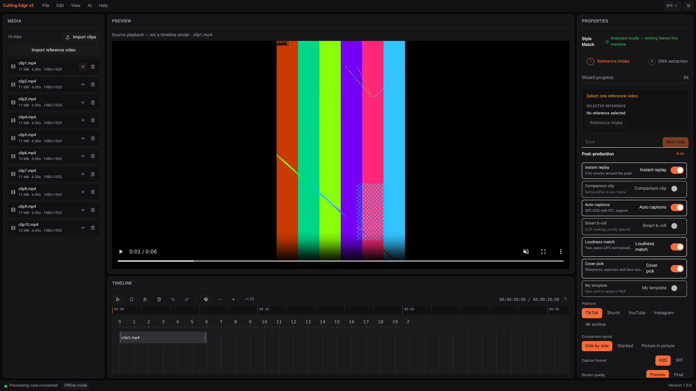

# Recovery loop R1 — real import and source playback

Date: **2026-11-04** · Branch `arena/dbb53bc2-cutting-edge-studio` · PR **#1** · Code commit `8dfb977`

## خلاصه

حلقهٔ بررسی → اصلاح → تست → ثبت شواهد از سر گرفته شد. بررسی CapCut و Filmora در
[نقشهٔ راه بازیابی](RECOVERY-ROADMAP.md) قرار گرفت؛ قرارداد مقایسهٔ C1 مشخص شده، اما بررسی
عملی رقبا هنوز انجام نشده است و هیچ ادعای تأییدنشده‌ای دربارهٔ قابلیت‌هایشان نداریم.

**R1 در محیط مرورگر/بک‌اند محلی قبول شد:** انتخاب فایل اکنون واقعاً فایل را به بک‌اند می‌رساند،
متادیتای ffprobe و شناسهٔ پایگاه داده برمی‌گردد و فایل منبع پخش می‌شود.
این پخش فایل منبع است، **نه اجرای تحلیل، پخش ترکیبی تایم‌لاین یا رندر نهایی**.

## 1. Changes

- Added `POST /api/v1/projects/{project_id}/uploads`, using FastAPI/Starlette `UploadFile` and the existing prober/asset service. No custom multipart parser or media algorithm.
- Sequential browser uploads create one backend project per editing session and store genuine backend IDs, storage paths, dimensions, fps and duration in the media store.
- Copies use UUID filenames, not client-supplied paths. Sources go under project imports; references/music/b-roll/voiceovers use the per-user role directories. Nonempty/20 GB file limit, extension and free-space checks, typed errors, structured backend logs, and failed-copy cleanup are included.
- Added `GET /api/v1/assets/{asset_id}/content` with Starlette `FileResponse` range support. Source playback uses native `<video>`/`<audio>` controls over a relative, same-origin asset URL. Codec errors are visible; files do not autoplay.
- Imported clip durations now come from ffprobe instead of an unconditional five-second default. The five-second fallback remains only for media without known duration (e.g. existing unit fixtures).
- Added a separate reference import control. The wizard can no longer silently use the first source as its reference. Deleting a reference invalidates the reference gate. Removing media already used on the timeline is blocked with a visible explanation.
- Disabled the unconnected Start analysis / edit-render actions and added bilingual explanations. Wizard navigation must not masquerade as inference or export.
- Added a narrow gitleaks exception for REA's content-derived script/resource identifiers and `shipped-artifact` authority label in exactly two evidence files; default detection remains enabled everywhere else. Regression coverage prevents broad path/credential exemptions.

## 2. Verification

| Gate | Result | Evidence |
|---|---|---|
| Backend lint | Clean | [backend.txt](evidence/recovery-r1/backend.txt) |
| Backend format | 72 files already formatted | same |
| Backend pytest | **133 passed**, **93.95%** coverage; gate 80% | [pytest.txt](evidence/recovery-r1/pytest.txt), backend output |
| Frontend lint | Passed | [frontend.txt](evidence/recovery-r1/frontend.txt) |
| Frontend tests | **118 passed**, 17 files | same; pre-existing React `act(...)` warnings remain |
| Frontend TypeScript/Vite build | Passed; 2,089 transformed modules, application chunk ~176.81 kB / 57.89 kB gzip | same |
| Live browser → backend acceptance | **18/18 passed**, no browser page exceptions | [browser-output.txt](evidence/recovery-r1/browser-output.txt), [browser-results.json](evidence/recovery-r1/browser-results.json) |
| Windows installation / actual edit export | **NOT CLAIMED** | still open |

The live browser test does **not** stub requests. Ten source files were selected through the file input, copied and probed by the real backend, and confirmed in the backend asset listing. It checks one created project, matching SHA-256 for a copied source, safe backend paths, HTTP `206` partial content, native browser decoding and advancing playback time, visible timeline action, duplicate rejection, explicit reference role, invalid-media error with no phantom DB entry, media-in-use protection, reference deletion gating and disabled unavailable actions.

Chromium reported the selected source as `readyState=4`, duration 6 s, no media error; playback advanced approximately **0.464 s** during observation. This verifies that source in this browser, not every supported container/codec or timeline synchronization. Inputs are the existing synthetic portrait test clips, not a real sports Golden Set. This continuation performs no video re-encoding and no forbidden encoder substitution.

### Screenshot — actual source playback, not an empty preview placeholder



[Explicit reference and blocked unavailable analysis](evidence/recovery-r1/02-explicit-reference-and-analysis-gate.png).

## 3. Observed failures and corrections

- The first browser driver attempt inspected its asynchronous response log too early and used a relative URL with a Playwright request context lacking `baseURL`. The driver was corrected to await response bodies and resolve API URLs against the preview origin. The full rerun passed; no app schema was weakened for the harness.
- Invalid MP4 data is rejected by real ffprobe; the copied file is removed, the asset list does not grow and the UI shows the backend error. Existing prober errors currently map this to 503 (`ffprobe unavailable`) even for malformed media; finer error classification remains a follow-up.
- Baseline CI `41878962714` had successful backend/frontend jobs but gitleaks reported findings; full redirected logs were inaccessible. Local reproduction of the upstream default generic-key rule identified content-derived REA `script_key`/`resource_key` IDs and its `shipped-artifact` authority label as matches. The committed exception is constrained by **both exact evidence paths and exact noncredential value patterns**. This is not a blanket JSON/evidence exclusion or a claim that the new CI run already passed.

## 4. Limits and next iteration

1. **R1b project/session reopening:** backend files and assets persist, but this iteration does not restore the frontend project/media/timeline workspace after reload. Original display names need persistent metadata. A project picker/save/reopen path is the next P0 reliability gate.
2. **R2 real analysis:** models, honest job progress and analysis orchestration are still required. No invented beat/shot labels should be shown as inference.
3. **R3 actual edit rendering:** preview/export need real render jobs, progress/cancel and approved NVENC/openh264 execution. Native source playback is not that deliverable.
4. **R4 desktop and packaging:** production Tauri transport without Vite, pinned model/runtime artifacts, Windows installer/offline acceptance and performance remain open.
5. **Competitors:** C1's shared task specification is recorded now. C2 needs official authorized local installations plus Windows execution; REA has **not** analyzed CapCut or Filmora. Lack of these artifacts does not stop R1b/R2/R3 work.
6. Browser uploads use Starlette's disk spool before copying into managed storage; large-file/low-temp-space stress testing remains open. The app does not claim zero-copy import, content-hash deduplication, upload cancellation or a pre-parser HTTP body quota. Names/sizes/roles deduplicate the current UI session only. Removing asset records preserves source files under the existing data-retention policy; managed-file garbage collection is not implemented here.

## 5. Reproduction

Backend must be restarted on current source with the temporary test FFmpeg path configured. No model weights are required for probing or source playback.

```sh
(cd backend && .venv/bin/ruff check . && .venv/bin/ruff format --check . && \
  .venv/bin/python -m pytest --cov=app --cov-report=term-missing)
(cd frontend && npm run lint && npm test -- --reporter=dot && npm run build)
NODE_PATH="$HOME/ce-test-tools/node_modules" \
LD_LIBRARY_PATH="$HOME/ce-test-tools/al2023/lib" \
node scripts/local-tests/recovery-import.cjs
```

Live-test prerequisites and external tool versions are described in the baseline [local report](LOCAL-TEST-REPORT.md). The test expects `/tmp/ce-media/clips/clip1.mp4` through `clip10.mp4` and `/tmp/ce-media/ref/reference.mp4`. It creates a real project/imports, so repeated runs consume local disk. No media/binaries/databases are committed. The old `ui-e2e.cjs` is explicitly labeled as a **historical driver for baseline commit 9122d6a**; use `recovery-import.cjs` for current R1 acceptance.

## 6. Evidence ledger

- `git log --oneline` snapshot: [git-log.txt](evidence/recovery-r1/git-log.txt).
- `git diff --stat` snapshot: [git-diff-stat.txt](evidence/recovery-r1/git-diff-stat.txt).
- Build and test outputs, browser results and screenshots: [`evidence/recovery-r1/`](evidence/recovery-r1/).
- Historical implementation count: step **260/260**, **100% authored**, **not 100% release accepted**.
- Recovery status: **R1 local pass (18/18)**; **C1 specification complete**, C2/C3 observations pending; R1b–R6 remain open. **Release is still BLOCKED.**
