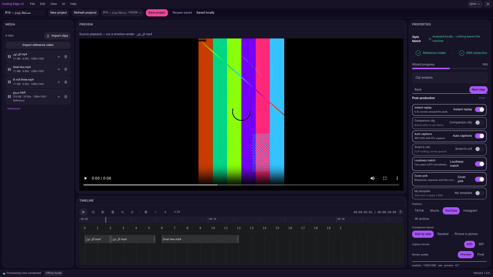
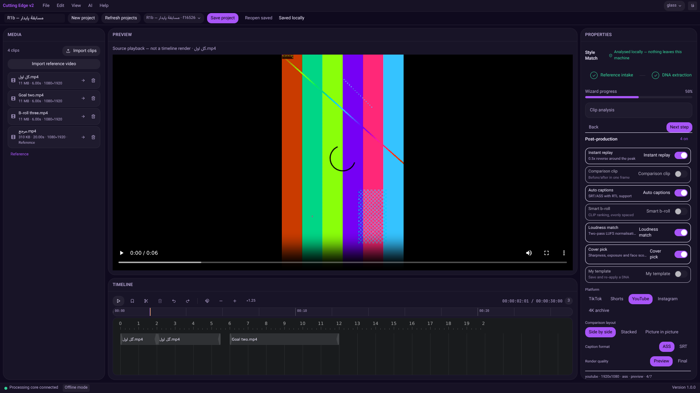

# Evidence Report — R1b local project save/reopen

Date: **2026-11-04** · Branch `arena/dbb53bc2-cutting-edge-studio` · PR **#1** · Code **`df8ccdc`**

## نتیجه / Verdict

**R1b در محیط محلی قبول شد: 26/26 آزمون واقعی مرورگر/بک‌اند.** نام اصلی فایل‌های جدید،
تایم‌لاین، بوک‌مارک‌ها، انتخاب رسانه/مرجع و تنظیمات پروژه پس از بازکردن دوباره بازیابی شدند.
بک‌اند واقعاً متوقف و با همان پایگاه داده دوباره اجرا شد؛ سپس مرورگر تازه پروژه را باز کرد.
تعارض دو تب، دادهٔ ذخیره‌شدهٔ نامعتبر، حذف رسانه و فایل خارج‌شده از دسترس نیز بررسی شدند.

**هنوز آمادهٔ انتشار نیست.** این مرحله تحلیل مدل، پخش ترکیبی تایم‌لاین، خروجی ویدیویی یا
نصب‌کنندهٔ کامل ویندوز را تأیید نمی‌کند. مرحلهٔ بعد **R2: اتصال تحلیل واقعی و پیشرفت کار** است.

**Step 260/260 = 100% historical authored steps**, unchanged. **R1b local checks: 26/26 = 100%.**
Neither percentage is an overall release-readiness percentage; release acceptance remains **BLOCKED**.

## 1. Implemented behavior

- A project toolbar, assembled from the existing React/Radix controls, supports naming, new project, project-list refresh, opening, explicit save and confirmed reopening of the saved revision. Labels are available in Persian and English.
- Document edits are automatically saved after an **800 ms** quiet interval. Save success is displayed only after the backend acknowledges a committed SQLite transaction. Failures retain dirty edits in memory and show an error; automatic retries do not loop indefinitely. Explicit Save retries are available.
- New/open operations save dirty work first and refuse to switch if saving fails or further changes remain. Navigation is serialized, workspace controls/hotkeys are blocked during hydration, and a browser `beforeunload` warning covers unsaved edits, in-flight saves and imports.
- SQLite remains authoritative. Browser storage contains only `cutting-edge.last-project`, the last successfully opened/saved project ID—not media, paths, editing snapshots or a shadow database. An empty browser profile can use the project picker to recover the document.
- Added typed `GET`/`PUT /api/v1/projects/{id}/workspace`. Pydantic validates format **version 1**, finite/bounded values, enum settings, unique timeline IDs, track references and source ownership/duration. Saves use a SHA-256 revision of the stored name/state and a conditional SQL update. A stale tab receives **409** rather than overwriting newer saved edits. Database write failures log an error and return **503**, not success.
- Zod **4.6.7 (MIT)** validates incoming snapshots/assets before frontend hydration. The existing Zustand stores and SQLAlchemy project row are reused; no custom JSON/multipart parser, media algorithm, model training or new persistence engine was introduced.
- Saved state includes tracks/mute/lock flags, clip order/start/duration/in-point/source path, bookmarks, timeline duration/playhead/zoom/snap, media ordering and selection, explicit reference ID, wizard **navigation location**, post settings, theme and language.
- Playback flags, source-player current time, clip selection, undo/redo history, import activity and analysis-completion claims are transient. Reopening pauses playback, clears history and resets wizard `completed=false`. Restoring the wizard page does **not** prove DNA extraction or inference ran.
- Browser imports now store original basename and byte size inside the existing `MediaAsset.probe_json` cache. Asset responses include display name, size and availability. **No SQLite column migration is required**: `Project.state_json` and `MediaAsset.probe_json` already exist. Legacy `{}` projects open as empty documents with their registered assets.
- Clip/bookmark creation now uses standard Web Crypto UUIDs. Repeated splits cannot reuse IDs restored from a prior numeric-ID session.
- The backend refuses deletion of sources used by the saved timeline. After intentional deletion of unused media, stale saved selection/order/reference IDs no longer prevent reopening: the UI warns, clears only the unavailable selection/reference, retains timeline edits, and does **not** automatically rewrite the original saved bytes. Missing files whose DB rows still exist remain visible with an availability warning.
- Unknown, corrupt or unsupported saved formats are surfaced and left unchanged. Unregistered timeline sources stop hydration before replacing the active document; no silent partial reset occurs.

## 2. Final verification

| Gate | Observed result | Evidence |
|---|---|---|
| Backend Ruff/format | All checks passed; 75 files formatted | [backend-lint.txt](evidence/recovery-r1b/backend-lint.txt) |
| Backend tests | **168 passed**, **94.38%** coverage (80% gate) | [backend-tests.txt](evidence/recovery-r1b/backend-tests.txt) |
| Frontend lint | Passed, zero lint warnings | [frontend-lint.txt](evidence/recovery-r1b/frontend-lint.txt) |
| Frontend tests | **143 passed / 19 files** | [frontend-tests.txt](evidence/recovery-r1b/frontend-tests.txt) |
| TypeScript/Vite production build | Passed; **2,187 modules**; application chunk **277.02 kB / 87.03 kB gzip** | [frontend-build.txt](evidence/recovery-r1b/frontend-build.txt) |
| npm audit, high+ threshold | Exit 0; **0 high/critical, 8 moderate** transitive development-tool findings remain | [frontend-audit.txt](evidence/recovery-r1b/frontend-audit.txt) |
| R1b real browser/backend | **26/26 PASS**, both phases, no page exceptions | [browser-results.json](evidence/recovery-r1b/browser-results.json), [prepare](evidence/recovery-r1b/browser-prepare.txt), [reopen](evidence/recovery-r1b/browser-reopen.txt) |
| R1 real-import regression | **18/18 PASS** on current code; source playback advanced **0.410008 s** | [r1-regression.txt](evidence/recovery-r1b/r1-regression.txt), [JSON](evidence/recovery-r1b/r1-regression.json) |
| Windows installer / real analysis / approved export | **NOT ACCEPTED** | Separate R2/R3/R4 gates remain open |

Non-fatal existing React `act(...)`/Radix test warnings remain in the raw frontend test output. Vite reports upstream annotation/empty-chunk warnings; the build exits successfully. An initially selected Zod 3.x version failed the high-severity audit and was replaced with the audited **4.6.7** pin before final verification; no vulnerable Zod 3.x dependency is retained.

Commands (repository-relative):

```sh
cd backend
.venv/bin/ruff check app tests
.venv/bin/ruff format --check app tests
.venv/bin/python -m pytest --cov=app --cov-report=term-missing
# 168 passed; coverage 94.38%

cd ../frontend
npm run lint
npm test
npm run build
npm audit --audit-level=high
# 143 passed; tsc/Vite successful; audit exits 0 with 8 moderate findings
```

## 3. Actual restart and browser evidence

The isolated test backend used `/tmp/ce-r1b-data`, install tools at `/tmp/ce-home`, and port **8757**. Vite listened on **0.0.0.0:1421** and proxied relative `/api` requests. Production/Tauri routing is not inferred from Vite.

1. `prepare` imported three real source fixtures and an explicit reference using the browser file inputs, including Persian filenames. It edited/split the timeline using UI controls, added a bookmark, changed zoom/snap/theme/post settings and saved through the real backend.
2. Numeric trim and track flags have no wired UI controls yet. The harness explicitly exercises their **actual Zustand actions**, not simulated backend responses; this limitation is recorded in its JSON output. Their persistence is also covered by API/store tests.
3. The test reloaded the page, created a separate blank project, reopened through the picker and compared snapshots. Two real tabs then saved competing names: the stale tab received 409, retained its unsaved text, and recovered only through confirmed reopen.
4. It verified unsupported state remains byte-for-byte intact, backend saved-timeline deletion protection, and reopening after deletion of an unused reference without silently saving over the old document.
5. The backend process **20979** was stopped completely and replaced by **21251**, using the same SQLite directory. `ps` output before/after and actual shutdown/startup logs are retained. The first browser process also closed.
6. `reopen` launched a new browser with only the saved browser-storage pointer. Snapshot and revision matched the saved server response exactly; no replacement project or upload was created. The restored native source decoded at **6 seconds**, using its original asset-ID URL and HTTP **206** range response.
7. Temporarily moving an unused managed file produced a visible warning while preserving all three timeline actions. The file was restored. A separately launched **empty-profile browser process** then recovered the same project entirely through the server-backed picker.

Evidence: [backend runtime](evidence/recovery-r1b/backend-runtime.log), [process before](evidence/recovery-r1b/backend-process-before.txt), [process after](evidence/recovery-r1b/backend-process-after.txt). Runtime errors for deliberately invalid saved state/media are expected negative-test observations, not hidden test failures.

The harness is [recovery-workspace.cjs](../scripts/local-tests/recovery-workspace.cjs). It uses external Playwright/Sparticuz tools through `NODE_PATH`; no test/browser dependency is bundled in the app. Run `prepare`, actually stop/restart the backend with the same data directory, then run `reopen`, supplying the observed backend PID through `CE_BACKEND_PID`. Start Vite fresh before the test: dev HMR timestamp URLs can otherwise create duplicate store instances when the harness imports modules for inspection. Empty-profile checks use a separate browser process because Sparticuz single-process flags can share storage between contexts.

### Saved document, before restart



### Recovered from SQLite in an independent empty browser profile



Additional screenshots: [reopened/conflict recovery](evidence/recovery-r1b/02-reopened-and-conflict-recovered.png), [missing-media warning](evidence/recovery-r1b/03-missing-media-preserves-edits.png).

## 4. Git and CI evidence

```text
git log --oneline -5
df8ccdc feat(workspace): save and reopen versioned local editing projects
d03a50c docs: schedule REA competitor benchmark and record R1 recovery evidence
8dfb977 feat(media): connect browser imports and source playback to real backend assets
9122d6a test: audit local app with REA and browser evidence; document release blockers
b93edd6 fix: harden media pipeline from local E2E findings and configure light runtime before cargo

git diff --stat d03a50c..df8ccdc
24 files changed, 2028 insertions(+), 49 deletions(-)
```

Full [git log](evidence/recovery-r1b/git-log.txt) and [code diff stat](evidence/recovery-r1b/git-diff-stat.txt) are retained. Evidence/docs are a separate follow-up commit; the quoted code range is intentionally fixed rather than self-referential.

The previously pending CI result is now known: [run 41881964341](https://github.com/yousefghorbanian98-create/Cutting-Edge-Studio./actions/runs/41881964341), for the prior R1/docs commit, passed backend, frontend and **gitleaks + Trivy**. **Windows NSIS failed.** Raw job conclusions are in [previous-ci.json](evidence/recovery-r1b/previous-ci.json). This confirms the earlier narrow REA allowlist passed that CI run, not a new R1b Windows or security acceptance. New R1b CI results remain pending at report authoring.

## 5. Limits and next gate

- Only **acknowledged saved state** is promised after restart. The debounce interval is not a crash journal; unsaved RAM edits can still be lost on power/process failure. There is no revision history, backup system, relink UI or Save As conflict-merge flow yet.
- Old imports created before original names were recorded cannot reconstruct those lost names from UUID paths; they use the stored path basename. Newly imported original names survive reload/restart.
- The picker currently uses the existing API's first page (default 100 projects). Large-project serialization, media-operation concurrency, pagination and performance still need dedicated acceptance; this is not a 200-clip/30-fps benchmark.
- Managed files are retained when DB assets are deleted, as in R1. No automatic destructive disk cleanup is introduced.
- Playback is **native source playback**, not composited timeline playback. Source-player playback position restarts; the separate timeline playhead is restored. No encoding was performed in this iteration and no prohibited encoder was substituted.
- Real sports Golden Set/model quality, approved LGPL FFmpeg + NVENC/openh264, complete offline models, production Tauri transport and Windows installation remain unaccepted.
- CapCut/Filmora comparison remains scheduled under C1/C2. No competitor installation was executed and no competitor behavior is claimed.

**Next: R2.** Audit the existing analysis services and replace disconnected/synthetic orchestration with real local jobs, measurable progress/results, and actionable missing-model errors. Keep the analysis/export controls honest until their own end-to-end gates pass. No owner approval or PR merge is requested by this report.
