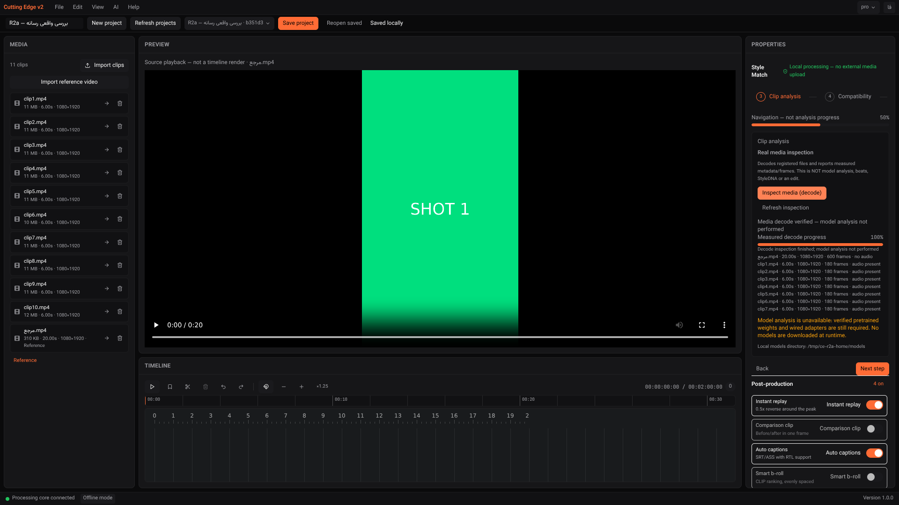

# Evidence Report — R2a real-media decode jobs

Date: **2026-11-04** · Branch `arena/dbb53bc2-cutting-edge-studio` · PR **#1** · Code **`675478c`**

## نتیجه / Verdict

**زیرمرحلهٔ R2a در محیط محلی قبول شد: 26/26 آزمون واقعی مرورگر/بک‌اند.**
مرجع و ۱۰ کلیپ منبع واقعاً با FFmpeg رمزگشایی شدند؛ ۲۴۰۰ فریم و زمان‌های خروجی اندازه‌گیری شد
و SHA-256 هر ۱۱ فایل مستقل تطبیق داده شد. پیشرفت واقعی، لغو، خطای decoder، بازیابی گزارش پس
از restart و وضعیت «متوقف‌شده» پس از کرش عمدی بک‌اند بررسی شدند.

**این پایان R2 نیست.** این مسیر فقط **media inspection** است؛ هیچ beat، shot، pose، تشخیص
ورزش، StyleDNA یا EDL تولید نمی‌کند. اتصال مدل‌های ازپیش‌آموزش‌دیده، خروجی ویدیویی و پذیرش
ویندوز هنوز باز است. **Release acceptance: BLOCKED.**

**Step 260/260 = 100% historical authored steps**, unchanged. **R2a local browser checks: 26/26 = 100%.**
Neither percentage is overall release readiness. Full R2 remains **OPEN**.

## 1. Implemented scope

- Added project-scoped `/api/v1/projects/{id}/inspection/{capabilities,jobs,latest}` and job read/cancel routes. Input accepts only registered reference/source asset IDs, not paths, supplied labels or analysis dictionaries. Project ownership, explicit roles, distinct IDs, availability and 1–100 source limits are enforced server-side.
- Reuses existing SQLAlchemy `Artifact` rows and `JobRegistry`, without a new database migration, queue server or media/inference framework. The accepted job is committed before work starts. One inspection worker is allowed globally; competing requests receive **409**.
- Actual work: SHA-256 via Python standard library, ffprobe metadata and complete FFmpeg decode of the first video/audio streams to the null sink. There is **no video export encoder invocation**. Failed probing/decoding, changed inputs or zero decoded video frames fail the job rather than becoming measured success.
- Progress comes from existing FFmpeg `-progress` parsing, weighted equally across input files, **not elapsed-time estimates or model completion**. Hashing/probing need not advance decode percentage. Progress is capped below 100 until the terminal report has been committed; persistence failures are logged and shown as failed, not done.
- Job identity/initial state and terminal reports survive restarts. Live intermediate percentages are in memory, not a crash journal. An orphaned queued/running record becomes **interrupted** on read after restart; it is not silently resumed or completed.
- Cancellation signals the running subprocess, kills/reaps it and commits a cancelled state without a report. Explicit retry creates a new job. Completed jobs cannot be cancelled into another state. Shutdown requests cancellation and joins for up to five seconds, logging a timeout if cleanup cannot finish.
- Completed reports include input IDs/names, SHA-256, size/mtime, duration, dimensions, fps, codecs, audio presence and observed frames/time. Later missing files, role changes or size/mtime changes mark the report stale. Stale checks do **not** rehash unchanged-looking files on every poll; they are not a tamper-proof filesystem monitor.
- Runner now drains stderr into a temporary file instead of an undrained pipe, avoiding stdout/stderr back-pressure deadlocks. Returned stderr is limited to the final **64 KiB**; stdout is limited to **8 MiB**. Cancellation, timeout and callback failures reap the child. UTF-8 decoding uses replacement for invalid diagnostic bytes. Temporary stderr disk usage is not a fixed-size ring buffer; per-command time limits remain relevant.
- Inspection probe timeout is **60 s**, decode timeout **300 s per file**, one worker; these are not a measured whole-job latency, memory or performance guarantee.
- The wizard's third navigation page composes existing React/Radix controls for start/poll/cancel/refresh, measured results, stale/error messages and missing-model notices. Polls are abortable, keyed by project, and stop on terminal states/errors. Schema validation rejects success-shaped responses without a report. Reference/source changes warn that an older report is not current.
- Wizard navigation is explicitly labelled **not analysis progress**; visited pages no longer receive false completion checks. Final model analysis and preview/export remain blocked. No runtime downloads, training, custom ML, media-processing algorithms or new dependencies were added.

## 2. Verification results

| Gate | Observed result | Evidence |
|---|---|---|
| Backend lint/format | Passed; **79 files** formatted | [backend-lint.txt](evidence/recovery-r2a/backend-lint.txt) |
| Full backend suite | **199 passed**, coverage **94.59%** (80% gate) | [backend-tests.txt](evidence/recovery-r2a/backend-tests.txt) |
| Frontend lint | Passed, zero lint warnings | [frontend-lint.txt](evidence/recovery-r2a/frontend-lint.txt) |
| Full frontend suite | **154 passed / 20 files** | [frontend-tests.txt](evidence/recovery-r2a/frontend-tests.txt) |
| TypeScript + production Vite build | Passed, **2,189 modules**, main application **286.47 kB / 89.67 kB gzip** | [frontend-build.txt](evidence/recovery-r2a/frontend-build.txt) |
| npm audit, high+ threshold | Exit 0; **0 high/critical; 8 moderate dev-tool findings remain** | [frontend-audit.txt](evidence/recovery-r2a/frontend-audit.txt) |
| Real inspection browser/backend | **26/26 PASS**, three phases, actual graceful restart and abrupt crash | [browser-results.json](evidence/recovery-r2a/browser-results.json), [prepare](evidence/recovery-r2a/browser-prepare.txt), [reopen](evidence/recovery-r2a/browser-reopen.txt), [interrupted](evidence/recovery-r2a/browser-interrupted.txt) |
| R1 real-import/playback regression | **18/18 PASS**, playback advanced **0.37824 s** | [r1-regression.txt](evidence/recovery-r2a/r1-regression.txt), [JSON](evidence/recovery-r2a/r1-regression/browser-results.json) |
| Approved BtbN Windows runtime / model inference / export / installer | **NOT ACCEPTED** | Remaining gates below |

Backend additions cover durable reports, scoped inputs/jobs, busy/cancel behavior, absent bundled tools, corrupted saved reports, commit failure, unsaved results, retry, restart/staleness and real-inspector command construction. Runner tests execute real local child processes for large stderr, cancellation, timeout, callback failure, stdout limits and invalid UTF-8. Frontend tests use **explicit API fixtures**, not actual inference; they cover progress, missing tools/inputs, cancellation acknowledgement, decoder/poll errors, retry, stale selection, malformed completion and late responses after project navigation. Live browser acceptance uses **no HTTP mocks**.

Expected error-case logs and existing non-fatal React `act(...)`/Radix warnings remain in the raw test output. Vite also emits upstream annotation/empty-chunk warnings. These are not hidden; all commands exited successfully.

Actual command-output excerpts:

```text
$ .venv/bin/ruff check app tests && .venv/bin/ruff format --check app tests
All checks passed!
79 files already formatted
$ .venv/bin/python -m pytest --cov=app --cov-report=term-missing
Required test coverage of 80.0% reached. Total coverage: 94.59%
199 passed in 10.30s
$ npm test
Test Files  20 passed (20)
Tests       154 passed (154)
$ npm run build
✓ 2189 modules transformed.
dist/assets/index-C5RJ5nRc.js  286.47 kB │ gzip: 89.67 kB
✓ built in 4.04s
```

## 3. Genuine subprocess/browser evidence and tool provenance

Harness: [`scripts/local-tests/recovery-inspection.cjs`](../scripts/local-tests/recovery-inspection.cjs).
Private test data: `/tmp/ce-r2a-data`; backend port **8757**; Vite bound **0.0.0.0:1421**, proxying relative `/api`. The diagnostic UI/backend were stopped after acceptance. The main development UI remains on **1420**, with a restarted current-code backend and the original user-data directory unchanged.

1. Browser imported ten six-second H.264 source fixtures with audio and a twenty-second H.264 reference without audio. Before completion an actual GET observed **4.484848636%**, `running`, and **no report**. This percentage represents observed decode progress, not inference.
2. The completed report measured **600 reference frames + 10 × 180 source frames = 2,400**, decoded media time **80 s** in aggregate. SHA-256 was independently recomputed from each stored file. A browser reload recovered the same report without another POST/start.
3. Cancellation stopped a genuine decoder. Replacing a test input's bytes with an invalid container caused a real ffprobe failure, visible in the UI. Restoring the bytes and explicitly retrying produced new measured results. The earlier report became stale rather than being silently refreshed.
4. New-project navigation did not inherit old reports; cross-project reads returned **404**. Reopening the original project recovered its own report.
5. Actual backend PID **22948** stopped gracefully; PID **33709** restarted against the same SQLite data. An independent browser with no last-project pointer recovered identical committed results.
6. Missing-file detection warned without declaring fresh analysis. The harness then started another genuine job and sent **SIGKILL to 33709 while running**. Backend PID **33820** reopened the orphaned record as **interrupted**, with no report or false 100%. Explicit retry decoded all files again. No test FFmpeg process remained after completion.

**Important distribution limitation:** the approved BtbN release asset redirects to `objects.githubusercontent.com`, which is outside this sandbox's permitted network hosts. The older external diagnostic binaries from prior recovery work were **not used for these tests**. Instead, an unmodified local **FFmpeg n7.1.1 LGPL-2.1-or-later shared-library build** was built exclusively for this synthetic-fixture acceptance run. This is **not the approved pinned BtbN Windows runtime**, a shipping artifact, an encoder-acceptance result, or a security-qualified production build. No diagnostic binaries or source archives are committed/bundled.

Source: `https://codeload.github.com/FFmpeg/FFmpeg/tar.gz/refs/tags/n7.1.1`; resolved source commit `db69d06eeeab4f46da15030a80d539efb4503ca8`; source archive SHA-256 `f117507dc501f2a6c11f9241d8d0c3213846cfad91764361af37befd6b6c523d`.
Configuration disables autodetection/network/GPL and enables shared libraries and native H.264/AAC/HEVC decoders; only null-output/raw-frame/PCM output is configured. The initial H.264-only minimal build hit an upstream unresolved AOM film-grain symbol; enabling the existing native HEVC decoder resolved that dependency without modifying FFmpeg source. [Version/license/configuration, dynamic linkage and binary SHA-256 evidence](evidence/recovery-r2a/diagnostic-ffmpeg-provenance.txt).

To reproduce browser phases after separately provisioning compliant diagnostic tools, owned fixtures and external Playwright/Chromium libraries:

```sh
# Backend: CUTTING_EDGE_DATA_DIR=/tmp/ce-r2a-data CUTTING_EDGE_HOME=/tmp/ce-r2a-home
#          .venv/bin/python -m app --host 127.0.0.1 --port 8757
# UI: CUTTING_EDGE_BACKEND=http://127.0.0.1:8757 npm run dev -- --port 1421
export LD_LIBRARY_PATH=/home/user/ce-test-tools/al2023/lib
export NODE_PATH=/home/user/ce-test-tools/node_modules
CE_BACKEND_PID=<actual-python-pid> node scripts/local-tests/recovery-inspection.cjs prepare
# Gracefully stop/restart the private backend with the SAME data directory.
CE_BACKEND_PID=<new-python-pid> node scripts/local-tests/recovery-inspection.cjs reopen
# The reopen phase deliberately SIGKILLs that private backend. Restart it again.
CE_BACKEND_PID=<third-python-pid> node scripts/local-tests/recovery-inspection.cjs interrupted
```

The harness checks the targeted process's `/proc` command line before the deliberate crash. Run only against an isolated disposable test backend, never a user's active production session.

## 4. Screenshots

Actual browser screenshots, not generated illustrations:

- [01 — real decode running](evidence/recovery-r2a/01-real-decode-running.png)
- [02 — real decoder error](evidence/recovery-r2a/02-real-decoder-error.png)
- [03 — measured results, models blocked](evidence/recovery-r2a/03-measured-result-models-blocked.png)
- [04 — actual crash interrupted, no fake result](evidence/recovery-r2a/04-crash-interrupted-no-fake-result.png)
- [05 — measured recovery after crash](evidence/recovery-r2a/05-recovered-after-crash.png)



## 5. Git and Windows CI follow-up

[`git log --oneline -7`](evidence/recovery-r2a/git-log.txt) and [`git diff --stat fdcbc26..675478c`](evidence/recovery-r2a/git-diff-stat.txt): **18 files changed, 1,685 insertions, 55 deletions** in the code commit. Evidence/documentation is committed separately on the same branch/PR; the PR is left open for the Owner.

Previous CI [41891179779](https://github.com/yousefghorbanian98-create/Cutting-Edge-Studio./actions/runs/41891179779): Linux frontend/backend/security succeeded; Windows installer failed. Full log download is blocked by its external results host, but GitHub's check annotations expose the actual error: **ENOENT `C:\frontend\package.json`**. Tauri v2 runs frontend hooks from the project root, while the old `../frontend` prefix escaped `C:\build`. Both hooks now use `npm --prefix frontend ...`; a regression guard verifies their root-relative package path. This is a concrete configuration repair, **not evidence of a successful new Windows installer**. [Annotations](evidence/recovery-r2a/windows-installer-annotations.json), [prior jobs](evidence/recovery-r2a/previous-ci.json). CI for the new push is separate and must be assessed independently.

## 6. Remaining gates / next work

- **R2b OPEN:** audit approved local model artifacts/licences/hashes and wire genuine OSS pretrained beat/shot/pose/action adapters into jobs. Existing client-dictionary Style Match endpoints and placeholder registry loaders are not actual inference and are not used as proof here. Missing models remain actionable blockers; no runtime downloads or fabricated sports labels.
- **R3 OPEN:** genuine EDL/render execution with approved NVENC/openh264 encoder probing, output verification, progress/cancel/error. Null decode does not certify export.
- **R4 OPEN:** successful Windows build, pinned BtbN shared runtime/models/WebView2, production Tauri↔sidecar transport without Vite, offline install/launch/uninstall and size/security checks.
- **C2 BLOCKED:** authorized official CapCut/Filmora artifacts and a Windows execution environment are still absent; competitor observations remain UNKNOWN.
- **Release BLOCKED:** no installer-ready, full R2-complete, model-quality, performance or cross-platform acceptance claim is made.
