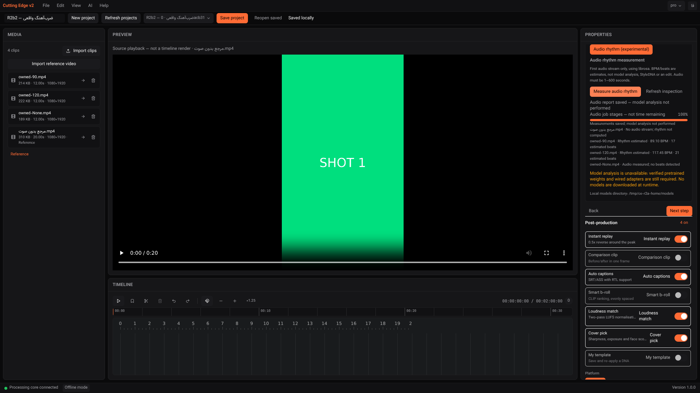

# Evidence Report — R2b2 experimental audio-rhythm jobs and UI

Date: **2026-11-05, Asia/Tehran**. Raw logs retain their actual UTC timestamps (November 4).
Branch: `arena/dbb53bc2-cutting-edge-studio` · PR **#1**, OPEN, Owner merges.
Code: **`d3e9c2a`**, after security-only `3a1446a`.

## خلاصه و دامنهٔ واقعی

اندازه‌گیری واقعی ضرب‌آهنگ به پروژه و رابط موجود متصل شد: FFmpeg صوت اولین جریان را استخراج
می‌کند و **librosa 0.11.0** در پردازهٔ جدا اجرا می‌شود. لغو، خطا، ذخیرهٔ گزارش، بازیابی بعد از
راه‌اندازی مجدد و توقف واقعی بک‌اند آزمایش شد. الگوریتم جدید تشخیص ضرب، آموزش مدل، صف‌ساز جدید
یا گردش‌کار واردشده از n8n وجود ندارد؛ این تغییر، کد اتصال و اعتبارسنجی روی اجزای موجود است.

**این فقط تحلیل تخمینی صوت در پروفایل آزمایشی محلی است، نه StyleDNA، تشخیص حرکت ورزشی،
برش شات، EDL یا خروجی تدوین‌شده.** قابلیت به‌صورت پیش‌فرض غیرفعال است. تست موسیقی واقعی و
پذیرش توزیع آفلاین ویندوز هنوز انجام نشده است؛ آماده‌بودن نصب‌کننده ادعا نمی‌شود.

**Step 260/260 = 100% historical authored steps**, unchanged; NOT 100% product acceptance.
R2b2 fresh browser acceptance: **23/23 checks**. Full R2/R3/R4/R6 remain OPEN/BLOCKED.

## 1. Reuse-first choices and necessary glue

| Need | Reused implementation | Alternative considered / decision |
|---|---|---|
| Beat/tempo estimates | Existing R2b1 adapter calls **librosa 0.11.0**, ISC | Beat-This would add another model/weights/deployment path; no reason to replace the already tested library here. No custom beat detector or training. |
| Audio decode/conversion | Existing resolved **FFmpeg** + shared runner; first stream → mono 22050 Hz, signed 16-bit WAV | Do not introduce another decoder/resampler or let the estimator load arbitrary media. No video encoder/export path invoked. |
| Jobs, cancellation, durability | Existing **InspectionService, JobRegistry, Artifact, SQLAlchemy and run_command** | A second broker/queue/workflow engine would duplicate the current local single-worker contract. No new scheduler, Celery service or imported n8n workflow. |
| Process liveness / crash protection | Already pinned **psutil 7.2.2**, BSD-3-Clause, plus standard subprocess/thread lifetime glue | Do not implement an OS process-enumeration library. Match parent PID **and creation time**; an independent child guard prevents continued analysis after the backend disappears. |
| API/JSON/UI | Existing **FastAPI/Pydantic**, **Zod**, React panel, shared Buttons/ProgressBar, Radix-based app shell | Add an operation discriminator, schema boundary and mode selector, rather than another analysis dashboard. This is custom integration/UI glue, not strict zero-new-code compliance. |

No default dependency pins changed. Optional/native provisioning and licences remain separate gates.
See [third-party qualification](../licenses/THIRD-PARTY.md) and the [R2b1 upstream provenance](RECOVERY-R2B1-REPORT.md).

## 2. Implemented contract

- `/api/v1/projects/{id}/rhythm/{capabilities,latest,jobs…}` reuses the inspection route factory.
  Only registered reference/source asset IDs are accepted. A single existing worker is shared
  across decode and rhythm; concurrent work returns **409**, not a second uncontrolled pipeline.
- Durable artifacts have kind **audio-rhythm**, separate from **media-inspection**. Operation,
  project and job identity are checked on reads, including stored payload/artifact consistency.
  Legacy decode records remain readable. Missing jobs return 404; unreadable records return an
  actionable logged 503 rather than being silently replaced.
- Every file records its **original imported-asset SHA-256**, size, mtime, ID, role and name.
  A separate derived PCM hash/sample count/duration accompanies an estimate. The parent validates
  child JSON, PCM hash and WAV frame count before persistence; it also rejects changed originals.
- Results explicitly distinguish **estimated**, **no-beats** (including measured silence), and
  **no-audio** (no estimate). Silence does not receive a fabricated BPM. A completed job means
  a report was saved, not that every file had detectable beats or that model analysis happened.
- Beat timestamps identify **`time_origin: extracted-pcm-start`**. They are NOT certified video
  timeline timestamps: stream offsets / edit alignment / EDL are separate unfinished work.
- Conservatively accept media with audio only when its probed container duration is 1–600 s;
  the extracted PCM must also be 1–600 s. `-t 601` limits extraction output, but **601 s is rejected**,
  not silently presented as a complete 600 s analysis. The first audio stream is the only one used.
- Hash cancellation / 60 s deadline are checked **between reads**, not a promise to interrupt a
  blocked kernel I/O call. Per-command limits: probe **60 s**, PCM extraction **120 s**, library
  worker **180 s**. The child additionally watches parent identity/liveness and a **185 s** lifetime.
  Library thread counts are set to one. These are per-file/stage limits, NOT a project-wide ETA,
  total project deadline, physical RAM limit or certified performance envelope.
- Progress reflects observed extraction and completed-file stages. It holds during library/JIT
  work; no timer invents percentages, success or a time remaining. The wizard's navigation bar
  remains explicitly separate from analysis progress.
- `CUTTING_EDGE_AUDIO_RHYTHM_ENABLED` defaults **false**. Enabling it is a local build/profile
  choice, not a licence certificate. Missing/wrong librosa is blocked with a build-time provisioning
  reason; no installation/download is performed by the feature. ABI/native failures still fail the
  genuine job visibly. Model analysis remains unavailable, even when audio is enabled.
- Frozen sidecar worker dispatch is authored and command/entry dispatch is tested in Python.
  **Actual frozen Windows worker execution is NOT tested.**

## 3. Fresh verification

| Check | Actual result | Evidence |
|---|---|---|
| Backend with opt-in real-library tests | **256 passed**, **93.80%** coverage; threshold 80% | [full output](evidence/recovery-r2b2/backend-optional-tests.txt) |
| Base test mode | **253 passed, 3 explicitly optional tests skipped** | [output](evidence/recovery-r2b2/backend-base-tests.txt) |
| Ruff lint + formatter | PASS, **87 files** formatted | [output](evidence/recovery-r2b2/backend-lint.txt) |
| Frontend tests | **161 passed**, 20 files | [output](evidence/recovery-r2b2/frontend-tests.txt) |
| Frontend lint / TypeScript / Vite production build | PASS | [lint](evidence/recovery-r2b2/frontend-lint.txt), [build](evidence/recovery-r2b2/frontend-build.txt) |
| Python audit, installed local environment | **No known vulnerabilities found** | [output](evidence/recovery-r2b2/python-audit.txt) |
| Frontend audit, high threshold | PASS at high/critical threshold; **8 moderate findings remain** | [output](evidence/recovery-r2b2/frontend-audit.txt) |
| Wheel build / metadata | PASS; default runtime excludes librosa/soxr; worker module included | [output](evidence/recovery-r2b2/wheel-build.txt) |
| Genuine browser/API/tool acceptance | **23/23**, no mocked API/measurement responses | [JSON](evidence/recovery-r2b2/real-browser-results.json), [prepare](evidence/recovery-r2b2/browser-prepare.txt), [reopen](evidence/recovery-r2b2/browser-reopen.txt), [crash recovery](evidence/recovery-r2b2/browser-interrupted.txt) |

There are **29 new backend tests and 7 new frontend tests** relative to R2b1. Injected unit
measurements are labelled fixtures; they are not counted as real analysis. Subprocess tests cover
independent worker termination even when logging encounters a broken parent pipe. Raw frontend
output includes existing nonfatal React/Radix/Vite warnings; no zero-warning claim is made.
The base-mode run used the provisioned local environment with opt-in tests disabled, not a newly
isolated no-librosa virtualenv. The wheel metadata and fresh base CI are separate checks.

Wheel SHA-256: `9bab06f243a9771d26af83dfb760e04b9fff200b3ffb03b779376146fddd83de`.
This wheel is NOT the native Windows sidecar or accepted installer.

## 4. Real browser, subprocess and restart observations

The fresh run uses disposable `/tmp/ce-r2b2-data`, not the user's primary data directory.
It imports a no-audio owned video reference plus three owned MP4 fixtures. Click/silence audio
comes from the upstream `librosa.clicks`/NumPy fixture approach in R2b1; FFmpeg copies existing
owned video and encodes audio with **native AAC**, never libx264. No third-party media is bundled.

| Owned stimulus | Actual estimate after MP4/AAC decode | Actual outcome |
|---|---:|---|
| 90 BPM clicks | **89.10290948275862 BPM**, **17 beats** | estimated |
| 120 BPM clicks | **117.45383522727273 BPM**, **21 beats** | estimated |
| Silence | **null BPM**, **0 beats** | no-beats |
| Video reference without an audio stream | no estimate | no-audio |

- During a genuine library subprocess, a GET observed **37.5%**, `running`, and **no report**.
  The harness waits until the worker has actually mapped LLVM/Numba's `libllvmlite`, rather than
  treating an idle mock as inference. Original imported-file hashes are independently recomputed.
- Selecting decode cannot display the audio report. Browser reload restores audio results when
  audio mode is selected, without another POST. The mode itself is ephemeral, not a persisted
  workspace preference. New-project state has no inherited report; cross-project job reads give 404.
- Cancellation kills and **reaps** the real library subprocess, leaves no result/100% success,
  and removes its temporary PCM/results. Corrupting actual source bytes causes real ffprobe
  failure visible in the UI. Restoring bytes does not silently refresh old provenance; retry is explicit.
- Backend PID **54932** stops gracefully. Fresh PID **55974** reopens identical durable results.
  The harness starts actual analysis and sends **SIGKILL to 55974**. Worker PID **56084** stops
  after **51 ms** in this observation. PID **56111** recovers the orphaned record as **interrupted**,
  with no report/false 100%; explicit retry runs the tools again and saves a new report.
- Persian labels and RTL render the recovered actual results. There are no browser JavaScript
  errors or external browser HTTP requests in the harness. A test-only external `sitecustomize`
  denies outgoing Python socket `connect`/`connect_ex` calls in the test backend and inherited
  worker environment. This is test evidence, not a Windows firewall/offline-install certificate.

**Crash limitation:** SIGKILL can leave disposable PCM cache files because parent cleanup cannot
run. This run left one **530,510-byte** WAV, with no live library worker. Automatic orphan-cache
GC and crash protection for a decoder killed during the extraction stage remain unfinished.
The child watchdog relies on Python scheduling; this is not a kernel/job-object guarantee against
all native-library hangs. `run_command` also retains the existing unbounded temporary stderr-disk
behavior (returned stderr tail is bounded). Do not claim global resource/crash hardening.

[Runtime configuration, binary/source hashes, dynamic linkage and process/cache evidence](evidence/recovery-r2b2/runtime-provenance.txt).
FFmpeg is an unmodified **n7.1.1 LGPL shared diagnostic Linux build**, with WAV/PCM and native
AAC/MP4 support added to the earlier diagnostic configuration. Source SHA-256 remains
`f117507dc501f2a6c11f9241d8d0c3213846cfad91764361af37befd6b6c523d`.
SoXR still dynamically resolves external `libsoxr.so.0`. These binaries/native builds are not
committed, approved BtbN Windows runtime, security-qualified production tools, or a shipping lock.

## 5. Actual screenshots



- [Real audio worker running](evidence/recovery-r2b2/01-real-audio-running.png)
- [Real ffprobe failure](evidence/recovery-r2b2/03-real-audio-failure.png)
- [Interrupted after actual backend crash](evidence/recovery-r2b2/04-crash-interrupted.png)
- [Recovered real audio report](evidence/recovery-r2b2/05-recovered-real-audio.png)
- [Persian / RTL results](evidence/recovery-r2b2/06-persian-real-audio.png)

These are fresh R2b2 screenshots, not generated illustrations or relabelled R2a evidence.
Prior R1/R2a browser suites were not rerun/relabelled here; current full unit regressions and
these 23 focused browser checks are the fresh evidence.

## 6. Git and security CI evidence

[`git log --oneline -7`](evidence/recovery-r2b2/git-log.txt) and
[`git diff --stat 3a1446a..d3e9c2a`](evidence/recovery-r2b2/git-diff-stat.txt):
**21 files changed, 1,377 insertions, 173 deletions** in the R2b2 code commit.
Evidence/docs are committed separately to the same branch/PR; no merge is performed.

Security commit **3a1446a** replaces the separately commercially licensed gitleaks-action wrapper
with official **MIT gitleaks CLI 8.30.1**, checksum-verified against the release API:
`551f6fc83ea457d62a0d98237cbad105af8d557003051f41f3e7ca7b3f2470eb`.
It scans full Git history, preserves nonzero failure status, publishes redacted SARIF and emits
locations only. That security commit introduced no new exclusions/allowlists. Old wrapper finding values/cause were **not
independently retrieved/reviewed**; they are not asserted to be false positives.

- PR run **41914773884** on 3a1446a: **SUCCESS**, including the pinned full-history scan.
  [Recorded jobs](evidence/recovery-r2b2/prior-pr-ci.json).
- Push run **41914765825** on 3a1446a: **SUCCESS**, including Windows NSIS **light build**.
  [Recorded jobs](evidence/recovery-r2b2/prior-push-ci.json),
  [artifact metadata](evidence/recovery-r2b2/prior-windows-artifacts.json).
  The artifact exists; executable/SHA archive contents were not downloaded or independently checked.
- That build uses **WithoutPinnedBinaries**, not the complete ~3.5 GB product/runtime bundle.
  Build success is not clean install, launch, worker, model, encoder, offline or uninstall acceptance.
- **New R2b2 revision CI is pending at report authoring**; the above runs are explicitly prior
  revision evidence, not substitutes for a fresh run. Native/optional licence and Windows acceptance
  remain open regardless of CI status.

The primary development preview on port 1420 was refreshed against the original user data
directory, with the experimental audio flag explicitly enabled for this provisioned Linux
development session. A read-only health/capabilities smoke through its relative `/api` proxy
passed. This does not change the default-disabled build setting or qualify distribution.
The disposable crash-test backend/UI were stopped after evidence collection.

### Fresh CI finding and narrowly scoped correction

The first new-revision PR run **41924525476** passed backend/frontend but failed the full-history
secret scan. Locations-only annotation identified **generic-api-key**, this report, line 161:
the public release archive digest following the words “release API”. This NEW finding was
independently reviewed and matched again to the official gitleaks v8.30.1 release asset metadata.
It is a public checksum, not an authentication credential. This does not resolve or reclassify
unretrieved historical wrapper findings.

One new exception requires **both** this exact report path and this exact checksum as the
scanner's secret value. No directory, commit, rule or general hex/checksum exclusion was added.
CI also runs the real pinned CLI on disposable history: the public digest in this report is
excluded, while another credential-shaped value in the same report AND the same digest in
another file must still produce two failures. Full real-repository history is still scanned;
redaction and failure exit status remain intact. Fresh post-correction CI is pending here.

## 7. Reproduction / next gates

After separately provisioning compliant diagnostic tools, the reviewed optional analysis profile,
owned media fixtures and external Playwright/Chromium test libraries, run the committed harness:

```sh
# Backend test profile, separate from native loopback-only entry point:
# CUTTING_EDGE_DATA_DIR=/tmp/ce-r2b2-data CUTTING_EDGE_HOME=/tmp/ce-r2a-home
# CUTTING_EDGE_AUDIO_RHYTHM_ENABLED=true PYTHONPATH=/tmp/ce-r2b2-offline:$PWD/backend
# backend/.venv/bin/python -m uvicorn app.main:app --host 0.0.0.0 --port 8757
# UI: CUTTING_EDGE_BACKEND=http://127.0.0.1:8757 npm run dev -- --port 1421
export NODE_PATH=/home/user/ce-test-tools/node_modules
export LD_LIBRARY_PATH=/home/user/ce-test-tools/al2023/lib
node scripts/local-tests/recovery-rhythm.cjs prepare
# Gracefully restart the isolated backend against the SAME data directory.
CE_BACKEND_PID=<actual-isolated-python-pid> node scripts/local-tests/recovery-rhythm.cjs reopen
# Reopen deliberately SIGKILLs that checked disposable backend. Restart it again.
node scripts/local-tests/recovery-rhythm.cjs interrupted
```

The external test-only `sitecustomize.py` overrides `socket.socket.connect` and `connect_ex` with
functions raising `RuntimeError`; its SHA is in runtime provenance. The harness requires the
owned 90/120/silence MP4 fixtures in `/tmp/ce-r2b2-fixtures` and prior owned reference video at
`/tmp/ce-media/ref/reference.mp4`; it does not download them. Run crash phases only on disposable
private data, never the user's active backend.

Next: continue genuine shot/model adapters and measured artifact wiring, broader authorized
real-music/quality inputs, original-timeline alignment, crash/cache/resource hardening, then
approved native packaging and actual Windows execution. R3 rendering/export and competitor
Windows observations remain separate OPEN/UNKNOWN gates; no full release or installer-ready
notification is justified yet.
