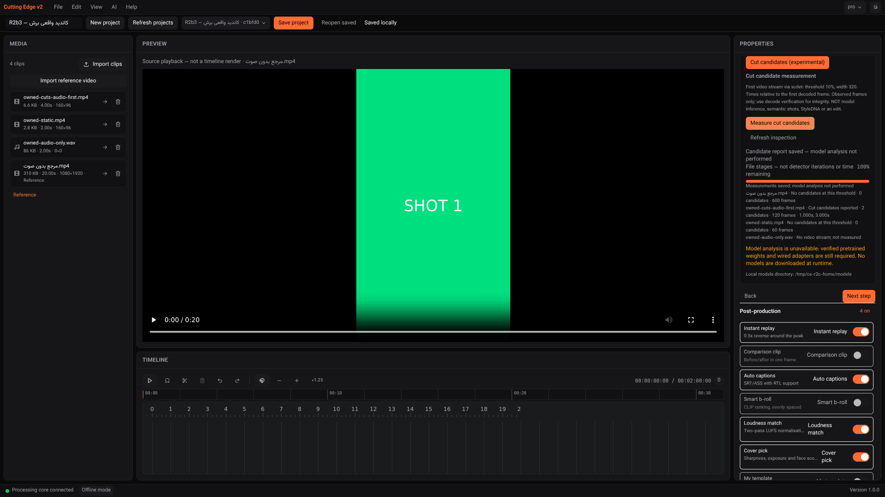
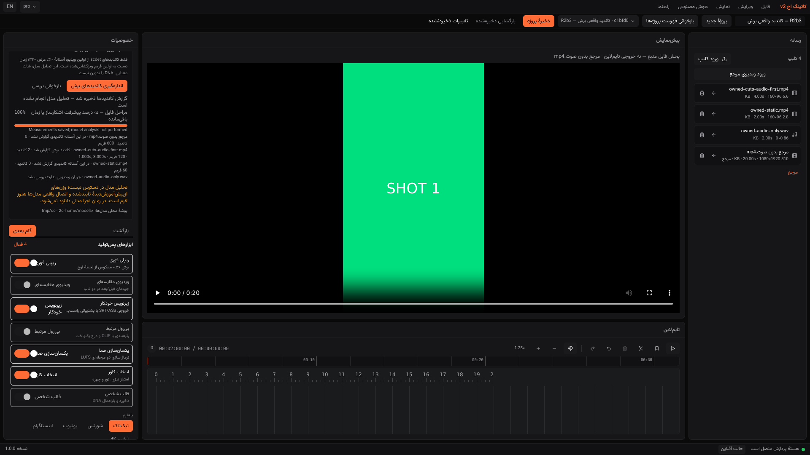

# Evidence Report — R2b3 native cut-candidate jobs

2026-11-05 · code **`d16b1b5`** · same branch / PR #1; Owner merges.

**LOCAL OWNED-STIMULUS PASS, experimental/default-disabled.** This is FFmpeg `scdet`
observation, **not** TransNetV2, pretrained inference, semantic shot detection, StyleDNA,
a generated edit, or an accepted Windows/offline product.

Historical implementation ledger: **step 260/260 authored = 100%**. Release acceptance
remains **BLOCKED**; there is no defensible overall readiness percentage.

## Inspect → reuse → minimal integration

Native Windows feasibility was already proven by the preceding step; it was not treated as
pending. Reused the LGPL FFmpeg **movie → scale → scdet** filters, ffprobe's structured JSON,
Pydantic/Zod validation, the existing media command runner, single job worker, SQLite Artifact,
project identity checks, polling/cancellation and the same measurement panel and translations.
No detector, ML model, training, score estimator or text-output parser was written.

The preceding [native-tool report](NATIVE-MEDIA-PREP-REPORT.md) records why adding
PySceneDetect/OpenCV/PyAV or unverified TransNetV2 artifacts was not selected for this bounded
experiment. This step adds no Python/npm runtime dependencies or downloadable weights.
Necessary new code is process/identity/validation/report glue and tests, not imported n8n workflows.

### Actual adapter contract

- Default `shot_candidates_enabled=False`; explicit build/development configuration is required.
  Missing tools/disabled profile give a visible reason and block starts. File presence is not
  model readiness or a native distribution/licence certificate.
- `/api/v1/projects/{id}/scenes/{capabilities,jobs,latest}` and job read/cancel reuse the existing
  route factory. Operation `scenes`, Artifact kind `shot-candidates`, report scope
  `shot-candidates-only`; decode/rhythm reports remain separate.
- Analyze the **first native video stream** at width 320, threshold 10%. Native `lavfi.scd.time`
  determines candidates; native scores are retained, not interpreted as confidence probabilities.
  All times are relative to the **first decoded video frame**, not container/music/EDL time.
  Original first-frame PTS is retained in the report.
- Bound video inputs to ≤600 seconds, ≤60 fps, ≤8192 per dimension / 33,177,600 pixels;
  ≤36,000 observed frames. Reuse 180-second native measurement and 60-second probe deadlines,
  8 MiB stdout retention and existing hash bounds. These are **not** a total project deadline,
  global RAM certificate, stderr-disk bound or dead-parent supervision guarantee.
- Native source paths never enter the lavfi graph. A fixed relative `input` hardlink in the
  local cache is used. Source and staged device/inode must match; symlinks or staging races
  fail. Baseline ctime is taken **after** linking. Hardlinking changes link count/ctime but
  does not copy or edit source bytes. Same-volume/local hardlink support is required;
  unsupported staging fails visibly, never silently copies large files.
- Original SHA-256, size, mtime, identity and role are preserved. Recheck input identity/stat
  after measurement. Original metadata probe and movie's nested demuxer explicitly allow
  only the `file` protocol for this operation.
- Reject empty/invalid/nonfinite/unordered/out-of-range JSON observations and native error
  stderr even on exit status zero. No partial successful report is committed on failure.
  A report describes **observed frames**, not an independent full-decode integrity certificate;
  the existing decode verification operation is still separate.
- Explicit `candidates`, `no-candidates` and `no-video` states. No-video is a skip, not a
  measured zero. UI displays counts, observed frames and up to 12 times; the saved report
  retains all candidates. Progress is file/hash/probe stages, not detector iterations/ETA.
- Existing durable done/failed/cancelled/interrupted states, stale warning, restart recovery,
  project/operation isolation and missing-model gate are retained.

## Executed evidence

### Owned media, real native adapter and UI

Generated our own black/white/static/silence stimuli using the diagnostic **LGPL shared**
FFmpeg n7.1.1 build; no third-party footage is committed or shipped. The fixture generator
uses native MPEG-4 Part 2 solely for test stimuli: **not** a production encoder fallback,
H.264 export acceptance or browser playback test. No libx264 was used. Source preview in
screenshots is the prior owned H.264 reference, explicitly **not a timeline render**; its
embedded “SHOT 1” text is stimulus content, not a generated analysis label.

| Actual imported input | Native result |
|---|---|
| Owned 20-second H.264 reference, no audio | 600 observed frames; no candidates at this threshold |
| Owned 4-second black→white→black clip, audio stream **before** video | 120 frames; video stream index **1**; candidates **1.000 s / frame 30** and **3.000 s / frame 90**, native scores **46.423** |
| Owned 2-second static video | 60 frames; explicit no-candidates |
| Owned 2-second WAV | Explicit no-video; no estimate |

- **25/25 live browser checks PASS** across prepare, actual graceful backend restart,
  SIGKILL/restart/interrupted/retry and final-code verification. No API/native-result mocks.
- Observed real native PID and running **2.5% file-stage** state with no premature report.
- Actual cancellation reaped the observed native decoder and removed its temporary hardlink
  workspace; no successful report or false 100%.
- Deliberately corrupt owned source produced a visible native ffprobe error and failed job.
  Restoring bytes did not silently refresh the old report: stale remained explicit.
- Original hashes independently checked; reload/restart retained reports; new/other projects
  did not inherit results. Switching to decode did not display candidate results.
- Final-code rerun produced the same actual candidate truth/hashes. English and Persian/RTL
  results captured. Zero browser JavaScript errors or external browser HTTP requests observed.
- Test-only outgoing **Python** socket denial was active on the disposable API; native tools
  were compiled with network disabled. This is scoped execution evidence, **not** a complete
  installed-product/offline traffic certificate.
- Primary UI/API were refreshed separately after tests. All original primary DB rows across
  four tables remained identical to the pre-refresh SQLite backup. Test imports/crash were
  confined to disposable data; primary gets no new test fixtures.

[Browser output](evidence/recovery-r2b3/browser-output.txt) ·
[structured results/requests](evidence/recovery-r2b3/real-browser-results.json) ·
[direct native results](evidence/recovery-r2b3/native-adapter-owned-results.json) ·
[owned fixture specification](evidence/recovery-r2b3/owned-fixture-specification.json) ·
[runtime provenance](evidence/recovery-r2b3/runtime-provenance.json) ·
[native worker/error events](evidence/recovery-r2b3/native-worker-events.jsonl) ·
[primary data preservation](evidence/recovery-r2b3/primary-data-preservation.json).

### Tests/build

| Executed check | Result |
|---|---|
| Backend Ruff check + format | PASS |
| Full provisioned optional/native profile | **287 passed in 20.19 s**, **93.75%** branch coverage |
| Base test mode in this provisioned environment | **281 passed, 6 explicitly skipped in 7.56 s**; not a clean-environment claim |
| New scene tests | 27 glue/schema/job/negative tests + 3 opt-in actual owned native tests |
| Frontend ESLint + TypeScript | PASS |
| Frontend Vitest | **167 passed / 20 files** |
| Frontend production build | PASS, **3.97 s** |

[Backend full output](evidence/recovery-r2b3/backend-full.txt) ·
[base mode](evidence/recovery-r2b3/backend-base-profile.txt) ·
[lint](evidence/recovery-r2b3/backend-lint.txt) ·
[frontend lint/test/build](evidence/recovery-r2b3/frontend.txt) ·
[git log --oneline](evidence/recovery-r2b3/git-log.txt) ·
[git diff --stat e62f847..d16b1b5](evidence/recovery-r2b3/git-diff-stat.txt).

The initial minimal diagnostic FFmpeg profile returned exit zero but no ffprobe frames because
its `wrapped_avframe` decoder was absent. Enabled that ready native decoder; zero-frame output
is explicitly rejected and regression-tested. Native error stderr with status zero and an
input replacement between hardlink creation and baseline are also covered by negative tests.

### Actual screenshots





[Observed running job](evidence/recovery-r2b3/01-real-candidates-running.png) ·
[real corrupt-input failure](evidence/recovery-r2b3/03-real-candidates-failure.png) ·
[crash interruption](evidence/recovery-r2b3/04-crash-interrupted.png).

## Windows follow-up — scope must not be conflated

The prior strict `ffd3169` native step passed; its encompassing push run was subsequently
cancelled. Follow-up push **41926876782 on e62f847** is now actually **SUCCESS**, including
Windows job **126913815242**, the strict native probe **and NSIS light build**. Artifact
metadata includes native JSON **13369217887** (16,860 bytes) and setup **13369024984**
(67,798,337 bytes). Raw archives were not downloaded/independently inspected here.

[Actual inherited run/steps](evidence/recovery-r2b3/inherited-windows-light-run.json) ·
[artifact metadata](evidence/recovery-r2b3/inherited-windows-artifacts.json) ·
[GitHub run](https://github.com/yousefghorbanian98-create/Cutting-Edge-Studio./actions/runs/41926876782).

That revision precedes this adapter. It proves native CLI/light-build feasibility, **not**
Windows execution of these scene API/UI jobs, full native packaging, clean installed startup,
offline acceptance, NVENC performance or a complete installer. Fresh d16b1b5-containing CI
results must be read separately; no pending run is counted as passed here.

## Open findings / next gate

1. **Crash cleanup remains OPEN.** In the real SIGKILL test, native scdet was no longer live at
   the 204 ms observation, but its hardlink workspace remained. No independent native-child
   lifetime guard or Windows crash supervision is inferred. The harness has explicit QA-only
   native cleanup if needed (not needed in this observation), not product cleanup. Normal
   cancellation cleaned correctly; abrupt-exit orphan-cache GC is not implemented.
2. Source-built diagnostic Linux tools are **not** the pinned BtbN Windows distribution. The
   actual project adapter still needs Windows runtime/native packaging acceptance, licence
   inventory/resource layout, hostile/corrupt/VFR/offset media and authorized real sports/edit
   quality measurements. Native threshold candidates do not imply all real shot boundaries.
3. Keep genuine pretrained model/StyleDNA/EDL/render gates blocked. Model/WebView2 placeholder
   pins, production Tauri transport, full clean Windows install/offline acceptance remain open.
4. Next inspect/reuse gate: native child/crash/cache hardening and approved artifact/resource
   routing, before expanding to model inference. Do not relabel this diagnostic as installer-ready.

### Reproduce (separately provisioned, disposable test profile only)

```sh
# No download/install is performed by these commands. Supply reviewed native tools first.
backend/.venv/bin/python scripts/local-tests/scene-fixtures.py \
  /tmp/ce-r2c-home/binaries/ffmpeg/bin/ffmpeg /tmp/ce-r2c-fixtures
cd backend
CE_ANALYSIS_TESTS=1 CE_SCENE_NATIVE_TESTS=1 CE_SCENE_HOME=/tmp/ce-r2c-home \
  CE_SCENE_FIXTURES=/tmp/ce-r2c-fixtures .venv/bin/python -m pytest --cov=app -ra
cd ..
# From repository root, in separate terminals:
# Disposable API: CUTTING_EDGE_DATA_DIR=/tmp/ce-r2c-data
# CUTTING_EDGE_HOME=/tmp/ce-r2c-home CUTTING_EDGE_SHOT_CANDIDATES_ENABLED=true
# PYTHONPATH=/tmp/ce-r2b2-offline:$PWD/backend; uvicorn app.main:app --host 0.0.0.0 --port 8757
# UI (frontend directory): CUTTING_EDGE_BACKEND=http://127.0.0.1:8757 npm run dev -- --port 1421
export NODE_PATH=/home/user/ce-test-tools/node_modules
export LD_LIBRARY_PATH=/home/user/ce-test-tools/al2023/lib
node scripts/local-tests/recovery-scenes.cjs prepare
# Gracefully restart the disposable API with SAME data, never primary user data.
CE_BACKEND_PID=<actual-disposable-uvicorn-pid> node scripts/local-tests/recovery-scenes.cjs reopen
# That phase deliberately kills only the checked disposable backend. Restart it.
node scripts/local-tests/recovery-scenes.cjs interrupted
# Fresh final-code backend, same disposable data:
node scripts/local-tests/recovery-scenes.cjs verify
```

External browser libraries, socket guard and previous owned H.264 reference are prerequisites,
not product resources. A repeated fresh `prepare` requires disposable cache without a prior
crash orphan; do not call that manual QA preparation an app GC implementation.
