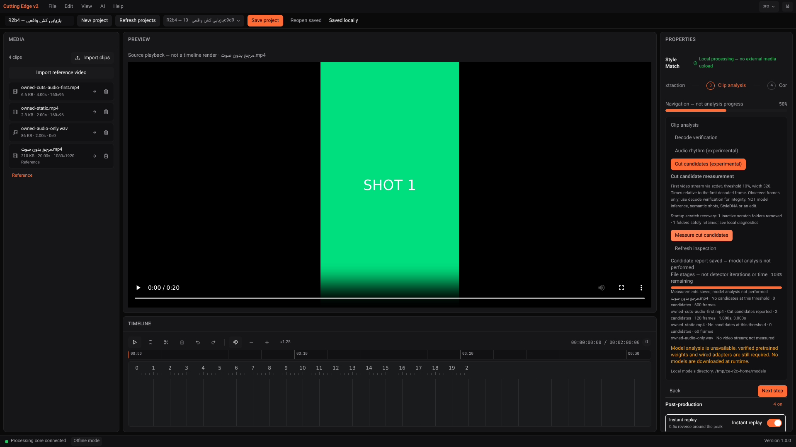
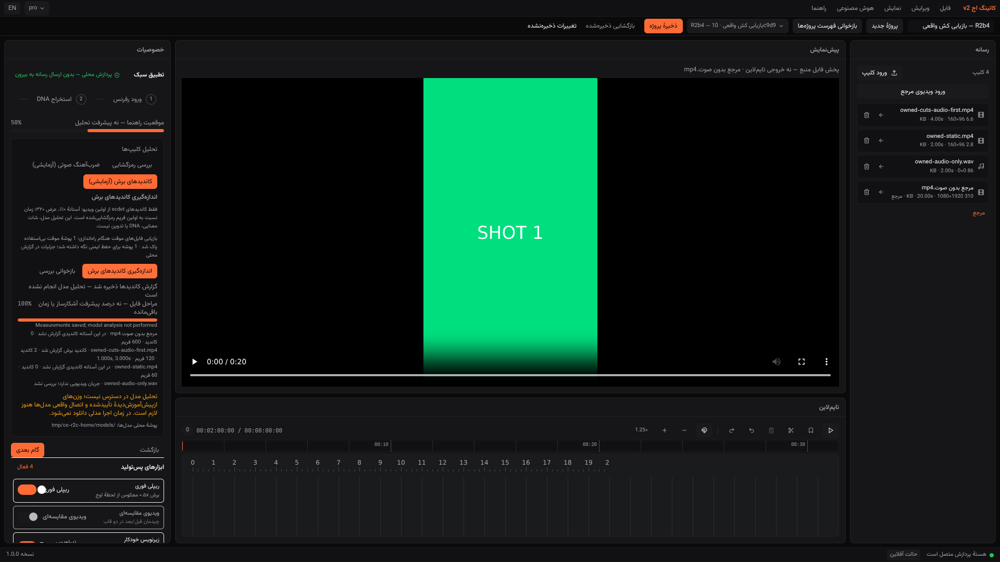

# Evidence Report — R2b4 conservative owned scratch recovery

2026-11-05 · code **`6060832`** · same branch / PR #1; Owner merges.

**LOCAL PASS for known inactive marked scratch.** This closes the observed retained-hardlink
and extracted-PCM cases for newly managed workspaces. It is **not** general cache deletion,
independent native-child containment, Windows runtime acceptance or installer readiness.
Historical authored ledger stays **260/260 = 100%**, not release readiness; release remains BLOCKED.

## Inspect → reuse → minimal glue

R2b3 actually left a hardlink workspace after SIGKILL; R2b2 had also left extracted PCM.
Unconditional age/prefix deletion cannot establish whether a native decoder still uses a file.
A backend-only lock would not by itself establish native-child exit or legacy ownership.

Reused existing **psutil** process identity/status, Python **tempfile / filesystem primitives**,
Pydantic JSON, the existing command runner, API route factory and measurement panel. No added
runtime dependency, custom detector/ML, kernel hook, download or imported n8n workflow.
The small new journal/allowlist/recovery code is application integration, not an OSS GC library.

### Implemented contract

- New scene and PCM/library workspaces use `managed-scenes-*` / `managed-rhythm-*`, created
  privately with tempfile. A versioned `.owner.json` records folder/kind, backend PID **and
  creation time**, launch-in-progress and native/library child PID/creation time.
- Journal publication uses a flushed/fsynced temporary file and atomic replacement. Record
  launch uncertainty **before Popen**, then actual child identity; clear it only **after wait/reap**.
  The runner's existing kill/reap `finally` encloses the child-registration callback, so a
  failing callback cannot bypass reaping. No shell or arbitrary journal-supplied command.
- Before DB/job startup, scan at most **128 cache entries total**, not an unlimited recursive
  sweep. Read at most **4,097 bytes** to enforce a **4 KiB** journal limit. Check owner/child
  creation times with psutil; a reused PID is not the recorded process.
- **Never kill a process for GC.** Live owner/child, access denied, unknown launch window,
  malformed/missing ownership, mismatched folder/kind, unexpected content, symlinks,
  Windows reparse/junction flags or nested directories are retained and reported.
- Delete only fixed, ordinary scratch files: marker/temp marker and `input` or
  `audio.wav`/`result.json`. No recursive directory removal or source-path deletion.
  Removing a cache hardlink leaves its original source bytes intact.
- Legacy `scenes-*`, `rhythm-*` and unrelated cache entries are **untouched**. No age heuristic
  upgrades an unmarked directory into trusted ownership. Ambiguous launches may remain
  indefinitely for review; this is intentional fail-closed behavior, not complete GC.
- Cleanup failures are logged and actionable. Recovery decisions appear in local diagnostics
  and capabilities. The existing panel shows a bilingual **startup snapshot** of removed/
  retained counts and scan limitation, separately from measurement/model success.
- Fixed diagnostics to use the **running app's injected settings**, not global settings that
  could describe the wrong test/profile directory.
- Scene/rhythm experiments remain default-disabled. Startup recovery only recognizes the new
  owned workspace format, including when those experiment flags are disabled.

## Actual crash and regression evidence

All imports are owned synthetic media, not bundled third-party footage. Same diagnostic LGPL
shared native binaries as R2b3; no new native encoder/library was provisioned. MPEG-4 fixture
encoding is only a stimulus, not a shipping H.264 fallback or export acceptance. Source playback
in screenshots is the owned reference, not a generated timeline; its “SHOT 1” text is embedded
stimulus content, not an analysis label.

### Scene/hardlink run — **29/29 browser checks PASS**

- Actually observed native scdet PID and matching backend/child journal before SIGKILL.
- Native PID was no longer live at **201 ms**; its workspace still existed before restart.
  This observation is **not** an independent native lifetime-guard claim.
- Real restart removed **1 proven inactive marked workspace**, retained **1 deliberately
  unmarked managed directory**, and left an additional **legacy sentinel** untouched.
- Existing UI displayed both startup counts; actual durable job became interrupted, not done.
  Explicit retry/final-code rerun recovered the same real 1/3-second native candidates and
  independently matching original hashes. Static/no-video, corrupt input, stale provenance,
  cancel/reaping, reload, project/operation isolation and English/Persian were rechecked.

### Audio/PCM run — **25/25 browser checks PASS**

- Actual FFmpeg extraction and librosa measurement still produced the owned 90/120 BPM,
  silence/no-audio results; original hashes independently verified. Normal cancellation
  reaped the library worker and removed its PCM/result workspace.
- Before actual backend SIGKILL, captured **530,510 bytes of genuine extracted PCM**, its
  SHA-256 and the journal matching the genuine library PID.
- The **existing** audio parent guard stopped that worker after **159 ms**. No new guard is
  claimed. On restart the new recovery removed the marked PCM workspace; unknown/legacy
  sentinels remained. Interrupted/retry and actual estimates were restored, not fabricated.

Both runs: **zero browser JS errors and external browser HTTP requests observed**, no native
result/API mocks. Test-only outgoing Python socket denial and network-disabled diagnostic
native tools were used; this is not a complete installed-product/offline certificate.

[Scene browser output](evidence/recovery-r2b4/browser-output.txt) ·
[scene results/journal/requests](evidence/recovery-r2b4/real-browser-results.json) ·
[audio browser output](evidence/recovery-r2b4/audio-browser-output.txt) ·
[audio results/PCM identity](evidence/recovery-r2b4/audio-regression/real-browser-results.json) ·
[recovery/worker events](evidence/recovery-r2b4/recovery-worker-events.jsonl) ·
[runtime/source provenance](evidence/recovery-r2b4/runtime-provenance.json).

### Tests/build

| Executed check | Actual result |
|---|---|
| Backend Ruff + format | PASS |
| Provisioned optional/native backend profile | **310 passed / 20.12 s**, **93.66%** branch coverage |
| Base test mode in provisioned environment | **304 passed + 6 explicit skips / 9.17 s**; not clean-environment proof |
| New workspace tests | **23**, including actual subprocess/abrupt-exit/startup, hook-failure reaping, live/reused/dead PID, launch uncertainty, links/reparse simulation, malformed/oversized metadata, permission failures and scan limit |
| Frontend ESLint + TypeScript + Vitest | PASS; **168 tests / 20 files** |
| Frontend production build | PASS; **4.79 s** |
| Live browser | **54/54 checks** across two genuine measurement/recovery runs |

Raw frontend log retains nonfatal React `act` test warnings; live browser had no JS errors.

[Backend full](evidence/recovery-r2b4/backend-full.txt) ·
[base mode](evidence/recovery-r2b4/backend-base-profile.txt) ·
[lint](evidence/recovery-r2b4/backend-lint.txt) ·
[frontend lint/test/build](evidence/recovery-r2b4/frontend.txt) ·
[git log --oneline](evidence/recovery-r2b4/git-log.txt) ·
[git diff --stat 20dec09..6060832](evidence/recovery-r2b4/git-diff-stat.txt).

### Actual UI screenshots





[Audio recovery/real estimates](evidence/recovery-r2b4/audio-regression/05-recovered-real-audio.png) ·
[audio Persian](evidence/recovery-r2b4/audio-regression/06-persian-real-audio.png) ·
[interrupted scene job](evidence/recovery-r2b4/04-crash-interrupted.png).

## Primary data and Windows scope

Primary API/UI refreshed separately, only after checking it was idle. All original rows in
projects, media assets, bookmarks and artifacts exactly matched the pre-refresh SQLite backup.
Primary recovery removed **0** directories; no QA fixtures/crashes were introduced there.
[Actual preservation check](evidence/recovery-r2b4/primary-data-preservation.json).

Previous push **41930777767 on 20dec09** now actually completed **SUCCESS**, including strict
Windows native assertions and NSIS **light** build. [Run/steps](evidence/recovery-r2b4/prior-windows-light-run.json),
[artifact metadata](evidence/recovery-r2b4/prior-windows-artifacts.json).
That predecessor does not execute this new cache adapter on Windows. Raw installer/native JSON
archives were not downloaded/independently inspected here. Fresh 6060832-containing CI is a
separate run; pending runs must not be counted as successful.

## Remaining gates / operating limits

- **Independent native process containment remains OPEN**, particularly Windows and native
  extraction-stage crashes. GC deliberately retains a still-live child and cannot restore a
  dead parent's deadline. Wait for exit and restart to retry conservative recovery; no broad
  kill/delete command is provided.
- Unknown launch-window/legacy/unmarked/invalid workspaces are not automatically purged.
  Inspect local `/api/v1/system/diagnostics` and logs; do not blanket-delete user cache.
- The private per-user cache is trusted against a malicious same-user filesystem actor.
  This is not hostile path-race, cross-instance transactional GC, power-loss, native stderr-disk,
  total-project deadline, disk quota or global CPU/RAM certification. Scan-budget exhaustion
  is surfaced, not silently declared fully clean. Windows reparse handling has unit simulation,
  not real Windows app/ACL acceptance in this step.
- Approved native artifact/resource routing, production Tauri transport, pretrained models,
  StyleDNA/EDL/render, full clean Windows install/offline and real sports/music quality remain
  OPEN/BLOCKED. No installer-ready or complete R2/R4 claim.

Next inspect/reuse gate: approved native resource layout/transport and native child containment,
not model training or fabricated analysis. Keep the same PR; Owner merges.

## Reproduce on disposable data only

Use the previously documented R2b3 owned fixtures and externally provisioned diagnostic tools,
optional audio environment, browser libraries and test-only socket guard. No runtime download.

```sh
# Separate terminals, repository root. Never point this crash harness at primary data.
# API: CUTTING_EDGE_DATA_DIR=/tmp/ce-r2d-data CUTTING_EDGE_HOME=/tmp/ce-r2c-home
# CUTTING_EDGE_SHOT_CANDIDATES_ENABLED=true CUTTING_EDGE_AUDIO_RHYTHM_ENABLED=true
# PYTHONPATH=/tmp/ce-r2b2-offline:$PWD/backend backend/.venv/bin/python -m uvicorn app.main:app --host 0.0.0.0 --port 8757
# UI (frontend/): CUTTING_EDGE_BACKEND=http://127.0.0.1:8757 npm run dev -- --port 1421
export NODE_PATH=/home/user/ce-test-tools/node_modules
export LD_LIBRARY_PATH=/home/user/ce-test-tools/al2023/lib
node scripts/local-tests/recovery-cache.cjs prepare
# Gracefully restart same disposable API/data.
CE_BACKEND_PID=<actual-disposable-pid> node scripts/local-tests/recovery-cache.cjs reopen
# Deliberately killed API: restart same disposable data, then:
node scripts/local-tests/recovery-cache.cjs interrupted
node scripts/local-tests/recovery-cache.cjs verify
node scripts/local-tests/recovery-cache-audio.cjs prepare
# Gracefully restart the API again.
CE_BACKEND_PID=<actual-disposable-pid> node scripts/local-tests/recovery-cache-audio.cjs reopen
# Restart after deliberate SIGKILL, then:
node scripts/local-tests/recovery-cache-audio.cjs interrupted
```

A repeated prepare needs a fresh disposable profile or carefully reviewed QA state; deliberate
unknown/legacy sentinels are intentionally left in place. Manual QA setup is not app GC.
